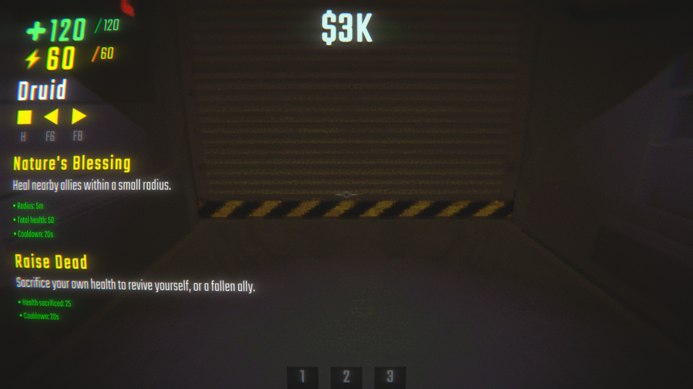
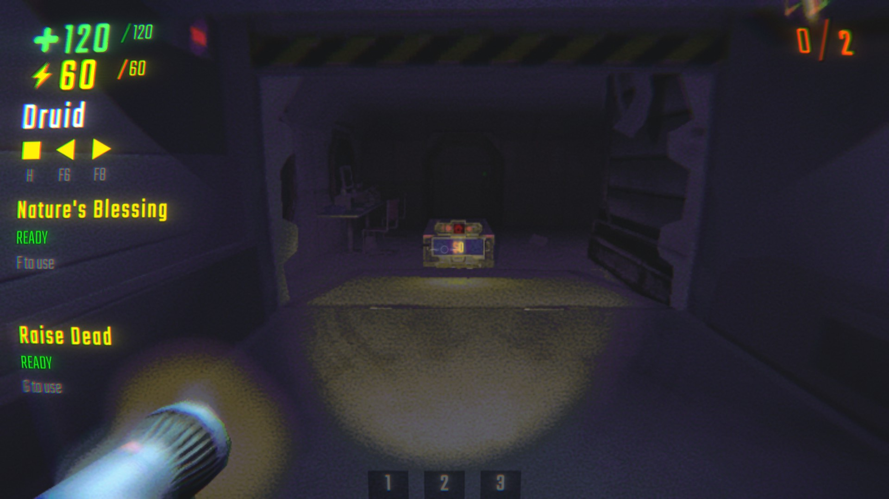

# RPG Skills Mod

Adds RPG classes to R.E.P.O., each with 2 unique active skills.

## Features

- 5 classes, each with 2 active skills and an in-game cooldown HUD
- Class selection in the shop and lobby, saved per save file
- Configurable keybinds: `F` / `R` use the skills, `F6` / `F8` change class, `H` shows/hides the HUD (see the BepInEx config)
- Multiplayer: skills with a world effect go through the host, so **the host must have the mod**

## Installation

Install **RPGSkillsMod** from [Thunderstore](https://thunderstore.io/c/repo/p/Spefire/RPGSkillsMod/) with your mod manager; BepInEx is installed automatically as a dependency.

## Classes & Skills

| Class | Skills |
|---|---|
| **Warrior** | Berserk, Predator Sense |
| **Paladin** | Divine Taunt, Shockwave |
| **Scout** | Best Runner, Treasure Sense |
| **Druid** | Nature's Blessing, Raise Dead |
| **Mage** | Phantom, Reinforce |

Full effect descriptions, cooldowns, radius and durations for every skill are on the **[Wiki](https://thunderstore.io/c/repo/p/Spefire/RPGSkillsMod/wiki)**.

## Screenshots

## Contact, Bugs & Ideas

- Open an issue: [GitHub Issues](https://github.com/Spefire/RPGSkillsMod_REPO/issues)
- Contact me directly via [Gmail](mailto:spefire@gmail.com) or [Ko-fi](https://ko-fi.com/spefire)

## License

This project is licensed under the MIT License.

Original repository: [RPGSkillsMod](https://github.com/Spefire/RPGSkillsMod_REPO/)
